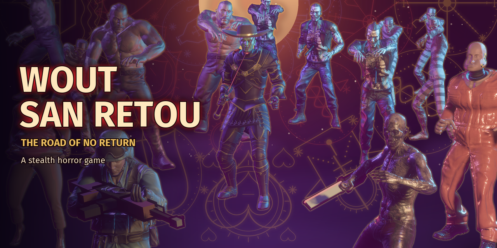
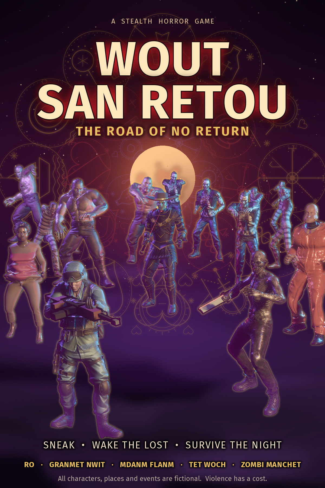

<p align="center"></p>

# Wout San Retou: The Road of No Return

A stealth-horror game about leaving a gang. You play **Ro**, a SWAT officer fighting through a gang's compound, and you find out
that violence has a cost: every kill adds Weight, the dead rise at night, and the "Lost" kids are not shot, they are reached
by name. Seven levels, from the yard to the rooftop, with Kreyol dialogue, Haitian Vodou imagery, and a kingpin who is a fraud.

> **All characters, places and events are fictional.** The game is about gangs, with horror and gunfire (no slow-motion
> kills, no gore as a reward). It is meant for teenagers and older. Haitian Vodou is shown as a religion, never as the villain.
> The Kreyol text still needs review by a native speaker.

<p align="center"></p>

## Play it

Rust and [Bevy 0.20](https://bevyengine.org/). You need a Rust toolchain.

```bash
cargo run --release        # the first build takes several minutes
```

| Key | Action | Key | Action |
|---|---|---|---|
| W A S D | move | E | use / wake someone by name |
| Shift | run | R | reload |
| C / Z | crouch / prone | G | grenade |
| Space | jump | F | knife |
| Mouse | look and aim | 1 to 4 | weapons |
| Left click | fire | V | first / third person |
| H | drink from a bottle | M | music on/off |
| F1 | hide the controls | F9 | leave a note for the developer |

### Characters and sound are packed into the game

The character models and animations come from [Mixamo](https://www.mixamo.com), which is free with an Adobe account. The
music and sound effects are third-party recordings and remixes. None of these raw files are in this repository, so nobody
can pull them out of it: they stay out of git, and `build.rs` packs them **inside the program file** when you build.

* **Built on the author's machine:** the executable contains every model, animation, sound, font and sigil, so the game
  is one file with all of its features. Run it from anywhere.
* **Built from a fresh clone:** the Mixamo and third-party files are not there, so they are not packed. The game still runs,
  with the characters missing and only the generated sounds (`assets/audio/synth`). To get everything: download the
  characters from Mixamo and run `tools/make_characters.py` (Blender needed), run `tools/build_audio.py` for the audio
  (see `assets/audio/README.md`), then `cargo build --release`. The build prints `embedding N asset files`.
* Anything not packed is still read from the `assets/` folder next to the executable, or the one beside `Cargo.toml`.

See [THIRD_PARTY.md](THIRD_PARTY.md) for the terms.

## Look at it without playing

`WSR_AUTOPLAY=1 cargo run --release` plays a scripted level offscreen and writes screenshots to `playtest/`
(`WSR_LEVEL2=1` to `WSR_LEVEL6=1` pick a level). `WSR_POSTER=1` renders the key art; see `tools/make_poster.py`.

## Roblox edition

[`roblox/`](roblox) holds a small, **non-violent** Roblox version: a new game inspired by this one, not a port. You are Ro at
night in a gang's compound: cut the power, sneak past the guards, call three Lost kids by name and lead them out. No weapons,
no gore, no Vodou imagery, no Kreyol and none of this game's models or sound. Open `roblox/WoutSanRetou.rbxlx` in Roblox Studio
and press Play. **It has not been run in Studio yet**, so expect bugs; see [roblox/README.md](roblox/README.md).

## Arcade edition (browser)

[`arcade/`](arcade) is a first-person arcade shooter in seven levels, from the yard to the rooftop, in plain JavaScript with no
libraries. Each level ends with its boss. Music is tiny MIDI files (written by `arcade/make_midi.py`) played by a small Web Audio
synth, and the gunshots are synthesised. Serve the folder (for example `python3 -m http.server --directory arcade`) and open it, or
play it at <https://ok-music.net/wout-san-retou/play/>. On ok-music.net, a signed-in player earns 0.1 LionCoin per kill in their OK Music
wallet, gets 20 chances a day, and can pay 2 LionCoin for 20 more. LionCoin is the site's in-app credit with no cash
value. Guests can play but earn nothing. The wallet link needs OK Music's Firebase scripts (`/firebase-init.js`), so a copy served
from anywhere else runs in guest mode.

## Folders

* `src/`: the game. `tools/`: Python and Blender scripts for models, audio, vever sigils and the poster.
* `design/`: the level plans and a Three.js preview of the compound. `promo/`: poster and social image. `roblox/`: the Roblox edition. `arcade/`: the browser arcade edition.

## Licence

The code is under the [PolyForm Noncommercial License 1.0.0](LICENSE): you may read, run and change it for noncommercial
purposes. **Commercial use, including selling the game or anything built from it, needs the author's written permission.**
The story, characters, poster and promo images, music and sound recordings are not covered by that licence: all rights in
them are reserved. Fonts and other third-party material have their own terms, see [THIRD_PARTY.md](THIRD_PARTY.md).
